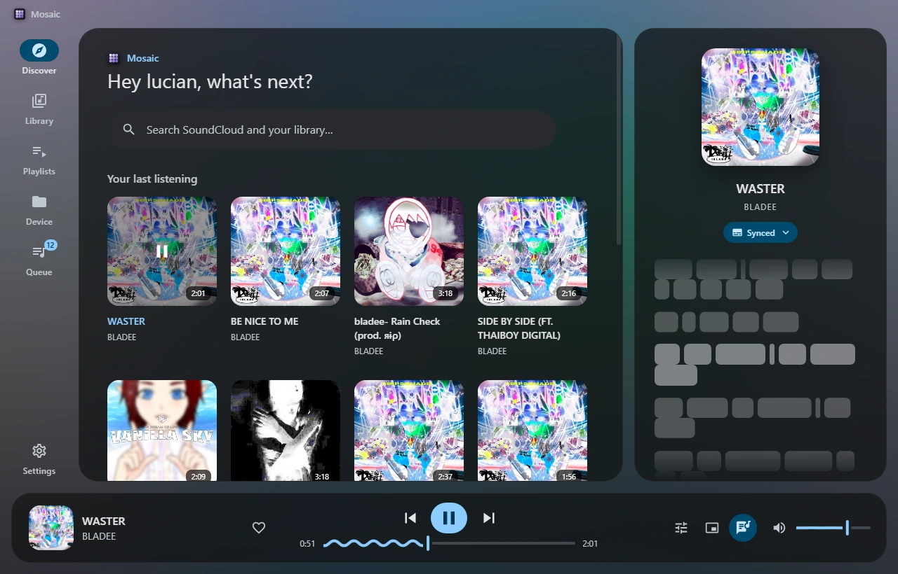
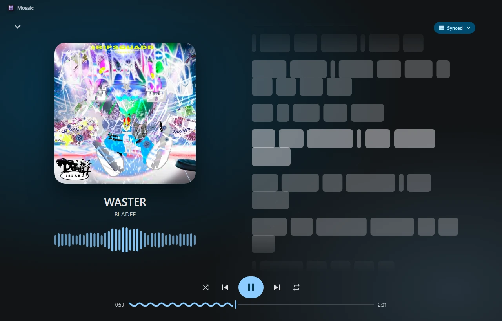

# mosaic


a desktop music player for soundcloud and your own files. native rust (iced), material you look, first-class linux support, still works on windows and macos.

- play soundcloud (no api key) and local folders in one queue
- word-by-word lyrics from lrclib, with a picker for other versions
- playlists, plus import from spotify links
- crossfade, gapless-ish transitions, equalizer, speed with pitch kept, sleep timer, mini player, discord rich presence
- colors follow the album art
- media keys and the system media widget through mpris (linux), smtc (windows) and now playing (macos)

<table>
  <tr>
    <td></td>
    <td></td>
  </tr>
</table>

## build it

the app lives in `native/`, a cargo workspace.

```
cd native
cargo run --release -p mosaic
```

you need a recent stable rust. on linux also `pkg-config`, alsa headers (`libasound2-dev` / `alsa-lib`), `libxkbcommon-dev` and `libwayland-dev`. press ctrl+k in the app for everything else.

`cargo packager --release` makes an appimage and a .deb on linux, an nsis installer on windows and a dmg on macos. a flatpak manifest and a gentoo ebuild are in `native/packaging/`.

`cargo build --no-default-features` leaves out the spotify player (librespot); spotify tracks then show as unavailable but browsing and import still work.

## linux notes

- audio goes through alsa via cpal; pipewire and pulseaudio provide the alsa shim, so `libasound2` / `alsa-lib` is the only runtime dependency
- wayland has no client-controlled always-on-top, so the mini player only stays on top on x11 and on compositors that allow it
- the window draws its own title bar. on a tiling wm start it with `MOSAIC_DECORATIONS=1` to use the compositor's decorations instead
- the tray needs a statusnotifier host (kde, or gnome with the appindicator extension). without one, closing the window quits instead of hiding to the tray, and settings says so
- `MOSAIC_REDUCED_MOTION=1` turns off animations, `MOSAIC_LOG=debug` turns up logging (`~/.cache/mosaic/mosaic.log`)
- data lives in `~/.local/share/mosaic`. on first launch your library from an earlier electron install is imported from `~/.config/Mosaic`

## what changed from the electron version

- doesnt use 235gb of ram
- doesnt use 232% cpu

`native/DECISIONS.md` lists every other deliberate difference.

## notes

- dont bug report, jsut make pr :3
- #claude wrote this
- credits to [monochrome](https://monochrome.st) as a service
