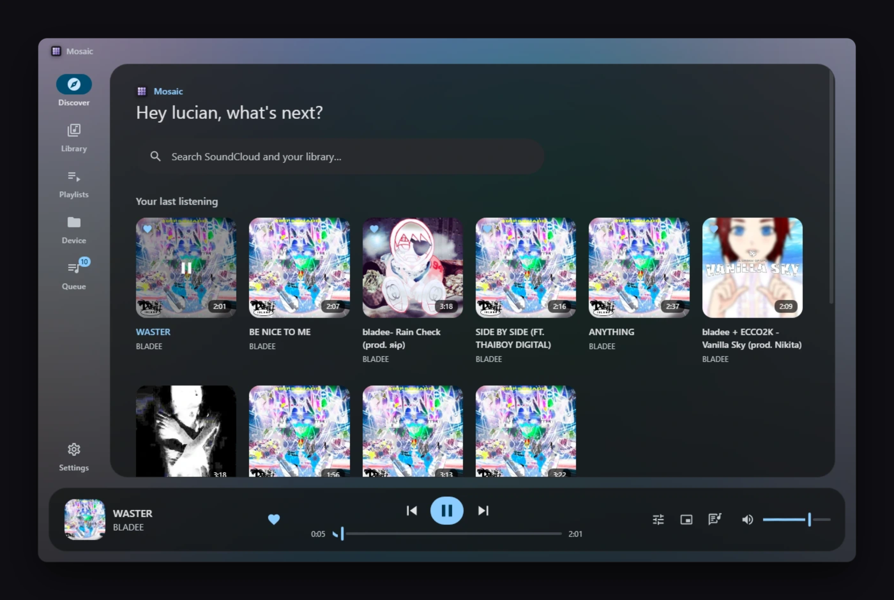
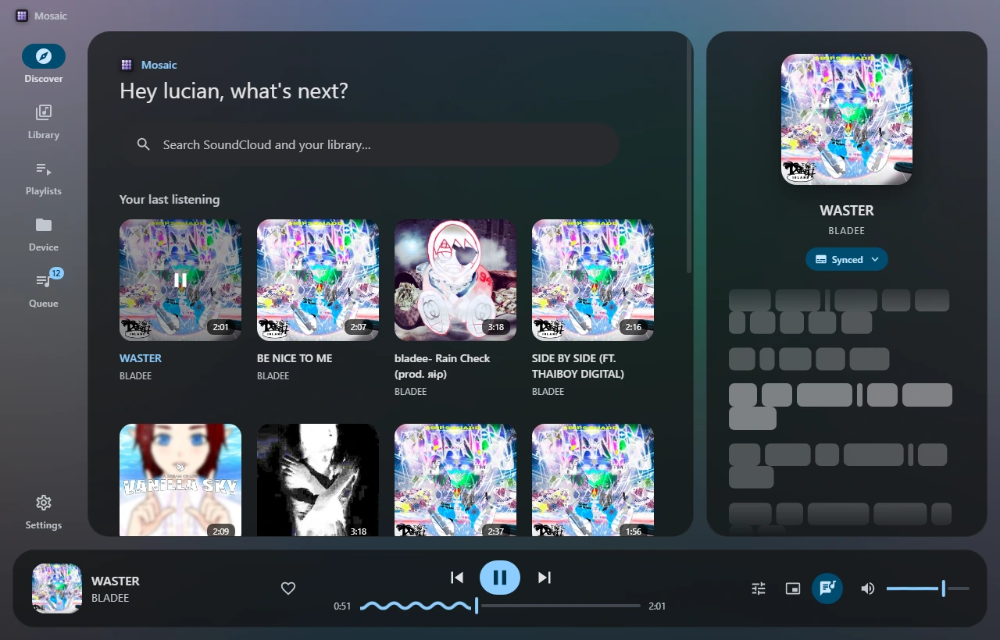
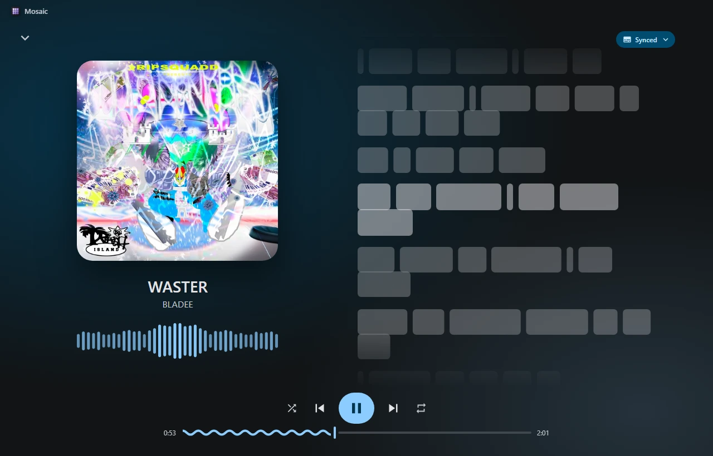

# mosaic



a desktop music player for soundcloud and your own files. electron + next.js, material you look.

- play soundcloud (no api key) and local folders in one queue
- word-by-word lyrics from lrclib, with a picker for other versions
- playlists, plus import from spotify links
- equalizer, sleep timer, mini player, discord rich presence
- colors follow the album art

<table>
  <tr>
    <td></td>
    <td></td>
  </tr>
</table>

## run it

```
npm install
npm run dev
```

`npm run dist` builds a windows installer. press ctrl+k in the app for everything else.

## notes

- soundcloud access is unofficial and can break. personal use only.
- not affiliated with soundcloud, spotify, discord or lrclib.

## more notes
- dont bug report, jsut make pr :3
- works on windows 10, havent tested on other 
